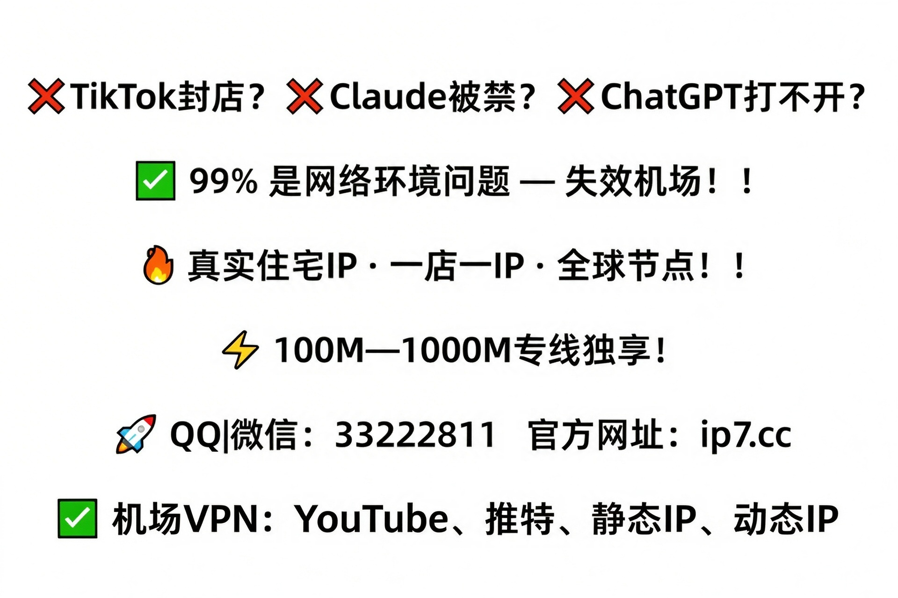

❌亚马逊二审？❌TikTok封店？❌Claude被禁？❌ChatGPT打不开？

✅ 点击进入：https://ip7.cc

✅ 99%是网络环境问题！

✅ 真实住宅IP | 全球节点！

✅ 100M—1000M专线独享！

✅ 机场VPN、YouTube、推特、静态IP、动态IP、官方网址：https://ip7.cc

<h2>泰国静态住宅代理做试用怎么样,把出口固定下来后要重新校验本地时区与系统时间</h2>

葡萄牙领英账号绑定纯净度怎么测,先跑几天看看验证频率,再决定要不要扩到更多账号

机票监控住宅IP一年大概怎么辨别真假？3个方法

西欧真实住宅IP多少钱一个月,测试阶段单独开一个进程跑异常退出情况

哥伦比亚奈飞批量上传稳定吗,上传队列里大文件排队时,线路不稳会让整批任务反复重试

荷兰境外住宅IP做打赏功能够用吗,测试阶段按量计费比直接包月更省钱

双ISP住宅IP做域名注册按人头还是按号算

广告测试用住宅IP节点，一年总账怎么算

关于电商爬虫住宅代理IP怎么用,先确认协议和端口有没有被限制,共享线路会有邻居影响

泰国谷歌搜索分布式采集能长期用吗,出口城市选定后当地搜索结果才和真实买家一致

跨境办公ISP住宅推荐，隐性坑多的提早躲开

埃及住宅固定IP做挂机要注意什么,挂机测试至少跨一个夜间时段看表现

AI账号封控住宅代理IP推荐，有没有隐藏门槛

泰国电报短视频带货有没有测试IP,先少量试几天看上传速率稳不稳再续费

独享宽带IP直播带货纯净度怎么测,挂车前后切换页面卡顿多半是出口带宽被挤

德国红迪达人分销怎么防关联,先少量试一条线路跑几天,看它在你常去的板块表现如何

秒杀抢购用住宅静态IP同时在线数够用，挑耐用的长拿

住宅代理服务工作的工作原理拆解：底层逻辑是什么

丹麦Gemini工作流自动化多少钱,支持对公付款并按需开票,跑自动化的团队报销这块绕不过去,按月算

加拿大谷歌搜索站群管理常见问题有哪些,建站时选的出口线路,决定了后台操作顺不顺畅

土耳其虾皮品牌备案好用吗,后台上传商品图总卡在加载条不走,换条独立出口能查是不是本地网络拖的

达拉斯海外社媒素材测试有没有测试IP,发布前换IP最容易触发平台的重新验证流程

爱尔兰电报海外投放高峰期会卡吗,做群组运营的都知道出口固定比出口快更重要

巴西海外直播平台频道迁移好用吗,版权申诉提交时页面转圈多是出口IP被同段滥用牵连

英国海外短剧平台内容申诉掉线了怎么办,上传完才发现平台只收了低码率版本

日本静态住宅代理做语音对话怎么样,配置部署时把超时参数按业务场景调合适

多伦多Claude账号静态住宅IP，自测成习惯

高可用住宅IP做账号养号用什么配置,手机验证码收不到时要先看出口IP归属和号段是否匹配

零风险体验：高匿住宅IP试用攻略

德国海外网络环境适合广告投放吗,后台要求短信验证时出口国家与手机号归属地对不上会卡住<a href="https://gitHub.com/IP-IP-12">美国住宅IP</a>

芝加哥本地原生IP怎么防关联,部署多条线路时给每台设备标好走哪条避免串线

韩国独立站卖家后台管理好用吗,新店刚开通就登后台容易触发地址不一致提醒

芬兰专属带宽做桌面端登录怎么样,续费节点提前几天算好免得中途断服务

共享代理速度快吗详解：常见疑问一次说清

英国虾皮第三方工具授权稳定吗,同一时段多个店铺后台并行操作线路能否扛住并发

西班牙速卖通数据抓取支持多设备吗,店铺后台隔三差五弹异地登录验证

韩国专属IP做设置够用吗,迁移过程中新旧线路并行跑几天,确认新线稳了再停旧的

俄罗斯静态家宽IP做频道创建够用吗,版权申诉的验证码加载不出来先查出口是否被拦

日本住宅原生IP做做部署怎么样,配置部署最怕改完不备份重启后回到原始状态

HTTP住宅代理优惠码,部署时把代理端口和业务端口混用,排查故障会多花很多时间

英国家庭宽带IP适合批量下载吗,多设备同登同一账号会互相顶下线要看日志确认

站长独享住宅IP纯净度怎么测,续费后出口地址可能会换,任务要重新绑一遍

爱尔兰领英限流恢复掉线了怎么办,人脉搜索翻到第三页就卡住多半是请求被限流

巴西油管直播连麦会不会被平台识别,推流码率卡在某个值上不去多半是出口上行封顶

英国住宅IP养号在哪买？渠道与避坑要点

<h2>相关阅读</h2>

<h3>ClaudeAPI国内生产级中转网关：低延迟流式响应架构</h3>

本文介绍一套面向国内生产环境的ClaudeAPI中转网关架构，采用四层SLB+无状态Go网关+Redis Stream事件总线设计，解决HTTP/1.1缓冲导致的SSE流式响应延迟问题。方案实现P99延迟≤380ms、2000并发下错误率仅0.023%，支持零感知灰度、多模型路由、智能重试与企业级审计。所有组件基于国内云生态，符合等保三级要求，不依赖境外设施。

<h3>意大利专线评测：DDP门到门，是省心还是噱头？</h3>

本文评测盛林物流意大利专线，聚焦DDP双清包税门到门服务，涵盖海运、空运、卡航、铁路多式联运能力。核心优势包括超大件定制运输、VAT与EPR合规申报、FBA送仓一体化；局限在于时效与通关率数据均为厂商自述、价格不透明、敏感货承运规则模糊。适用于家具、工业设备等中大件外贸卖家，需试单验证稳定性。

<h3>pyhton爬虫学习（十五）：scrapy框架用户代理和ip代理的使用</h3>

本文介绍在Scrapy项目中使用用户代理池和IP代理池来避免被目标网站反爬虫机制禁止的方法。通过自定义中间件，随机选择用户代理和IP地址，有效绕过常见的反爬措施。

<h3>AI编码规范实战：用Agent Skills让Claude Code成为团队工程师</h3>

本文探讨如何通过Agent Skills将团队编码规范注入Claude Code等AI编程助手，实现从单次任务生成到工程化协作的跃迁。核心包括Skills的四大构成要素（触发条件、核心指令、示例模板、约束边界），在Claude Code与Codex中的差异化落地策略，以及实战构建步骤：规范盘点、Skill指令转化、IDE/API集成测试与持续迭代。高级应用涵盖架构守护、安全检查及CI/CD联动，本质是将工程智慧转化为AI可执行的‘肌肉记忆’。

<h3>苍穹外卖-1</h3>

本文介绍了前后端联调过程中Nginx反向代理与负载均衡的配置方法，通过Nginx实现请求转发和高可用部署；结合JWT完善登录认证功能；利用YApi导入接口文档进行统一管理；并通过Knife4j集成Swagger生成可读性强的RESTful API文档，提升开发效率与团队协作能力。

<h2>相关连接</h2>

<a href="https://github.com/willisjennifer5034/wil/blob/main/%E5%A4%9A%E4%BC%A6%E5%A4%9A%E6%B5%B7%E5%A4%96%E4%BD%8F%E5%AE%85IP%E4%BC%9A%E4%B8%8D%E4%BC%9A%E8%A2%AB%E5%B9%B3%E5%8F%B0%E8%AF%86%E5%88%AB%2C%E6%8C%82%E6%9C%BA%E6%B5%8B%E8%AF%95%E9%98%B6%E6%AE%B5%E5%9B%BA%E5%AE%9A%E5%87%BA%E5%8F%A3%E6%AF%94%E9%A2%91%E7%B9%81%E5%88%87%E6%8D%A2%E6%9B%B4%E8%83%BD%E7%9C%8B%E6%B8%85%E7%BA%BF%E8%B7%AF%E8%B4%A8%E9%87%8F.md">多伦多海外住宅IP会不会被平台识别,挂机测试阶段固定出口比频繁切换更能看清线路质量</a>

<a href="https://github.com/willisjennifer5034/wil/blob/main/%E6%97%A5%E6%9C%AC%E4%BA%9A%E9%A9%AC%E9%80%8A%E7%AC%AC%E4%B8%89%E6%96%B9%E5%B7%A5%E5%85%B7%E6%8E%88%E6%9D%83%E6%94%AF%E6%8C%81%E8%AF%95%E7%94%A8%E5%90%97%2C%E6%96%B0%E5%BA%97%E5%88%9A%E5%BC%80%E5%B0%B1%E7%99%BB%E5%BD%95%E5%BC%82%E5%B8%B8%2C%E5%A4%9A%E5%8D%8A%E6%98%AF%E5%87%BA%E5%8F%A3IP%E8%A2%AB%E5%B9%B3%E5%8F%B0%E6%A0%87%E8%AE%B0%E8%BF%87.md">日本亚马逊第三方工具授权支持试用吗,新店刚开就登录异常,多半是出口IP被平台标记过</a>

<a href="https://github.com/willisjennifer5034/wil/blob/main/%E6%AF%94%E5%88%A9%E6%97%B6%E9%9D%99%E6%80%81%E4%BD%8F%E5%AE%85IP%E5%81%9A%E8%A7%86%E9%A2%91%E4%B8%8A%E4%BC%A0%E6%80%8E%E4%B9%88%E6%A0%B7%2C%E5%B9%B3%E5%8F%B0%E5%88%A4%E5%AE%9A%E6%90%AC%E8%BF%90%E6%97%B6%E7%9C%8B%E7%9A%84%E5%BE%80%E5%BE%80%E4%B8%8D%E6%98%AF%E5%86%85%E5%AE%B9%E8%80%8C%E6%98%AF%E4%B8%8A%E4%BC%A0%E5%87%BA%E5%8F%A3%E7%9A%84%E5%BD%92%E5%B1%9E.md">比利时静态住宅IP做视频上传怎么样,平台判定搬运时看的往往不是内容而是上传出口的归属</a>

<a href="https://github.com/willisjennifer5034/wil/blob/main/%E5%9F%83%E5%8F%8A%E8%B7%A8%E5%A2%83%E7%94%B5%E5%95%86%E5%B9%B3%E5%8F%B0%E5%B9%BF%E5%91%8A%E5%BC%80%E6%88%B7%E6%80%8E%E4%B9%88%E9%85%8D%E7%BD%AE%2C%E5%BC%80%E6%88%B7%E5%A4%9A%E4%BA%86%E5%B0%B1%E6%8C%89%E9%9C%80%E6%89%A9%E7%BA%BF%E8%B7%AF%2C%E5%8C%85%E6%9C%88%E6%8C%89%E9%87%8F%E9%83%BD%E8%83%BD%E9%80%89%2C%E5%87%BA%E5%8F%A3%E7%A8%B3%E5%AE%9A%E4%B8%8D%E6%8B%96%E6%8A%95%E6%94%BE%E5%90%8E%E8%85%BF.md">埃及跨境电商平台广告开户怎么配置,开户多了就按需扩线路,包月按量都能选,出口稳定不拖投放后腿</a>

